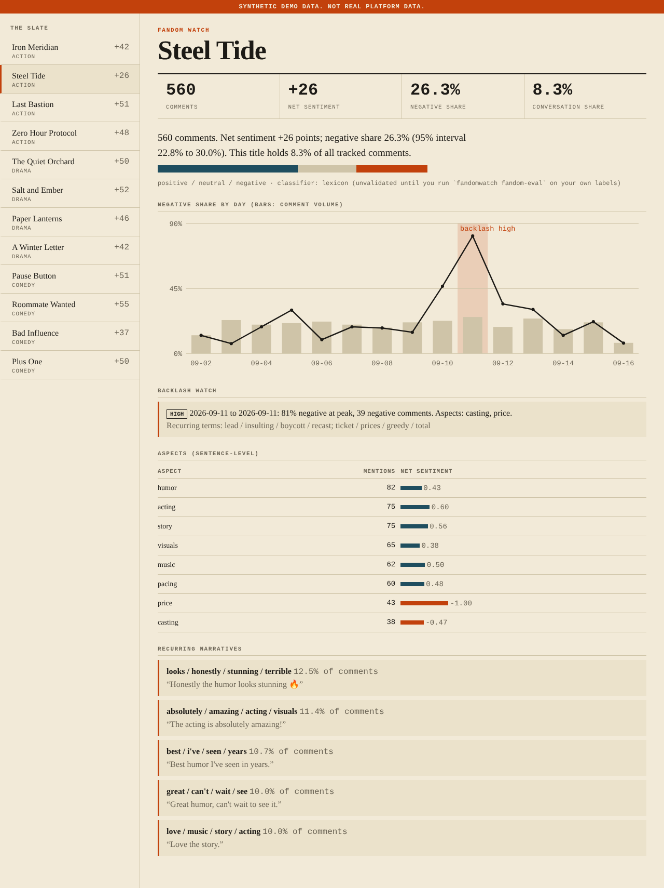
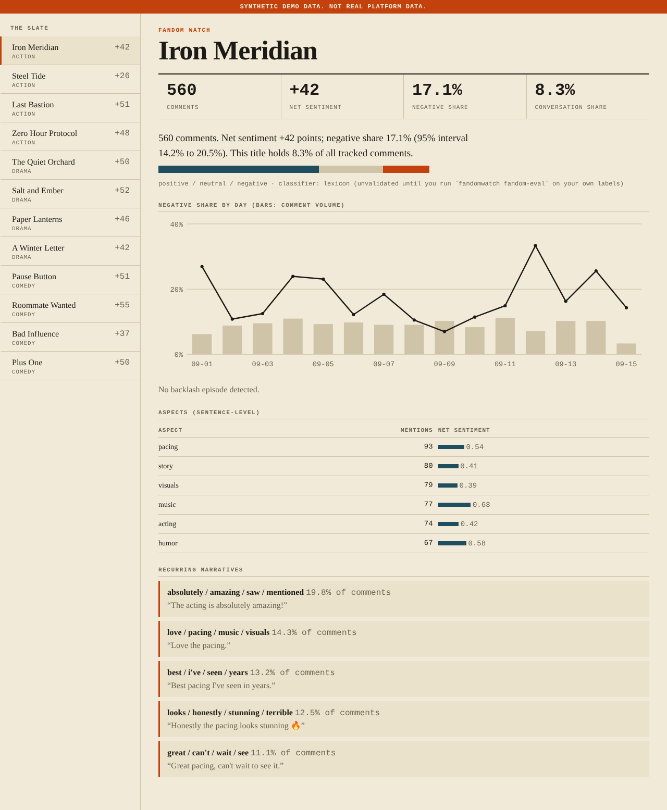
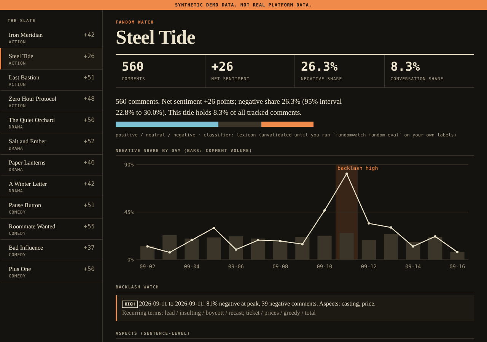
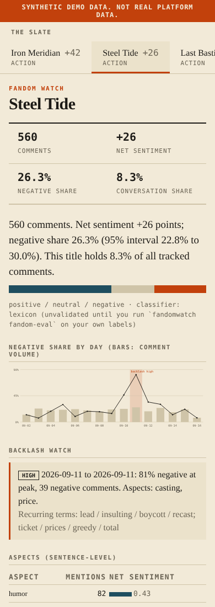
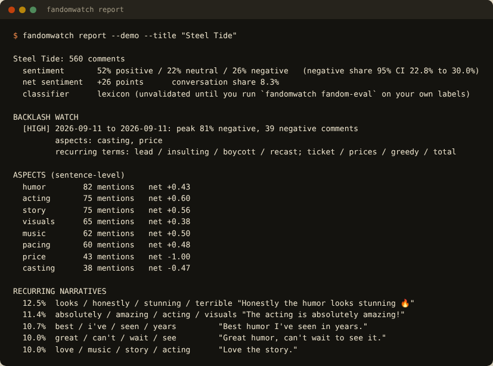

# FandomWatch: fan-conversation analytics

What are fans saying about a title, which **aspects** do they love or hate, which **narratives** keep recurring, and **when did a backlash start and what was it about?**

## Screenshots

> **About the screenshots.** All data shown is **synthetic** (the UI says so in an orange banner). Browser images are real captures of this project's own dashboard in Chromium; terminal images are the real stdout of each command, rendered into a terminal-styled page.

### A backlash, detected and explained


Steel Tide: the timeline shades the detected episode, the callout gives severity, peak negative share, negative-comment count, top aspects (casting, price) and recurring terms; the aspect table shows price at -1.00. (This is injected into the synthetic data to prove the detector.)

### A calm title


Iron Meridian: no episode is flagged, and the dashboard says so. A detector that cries wolf is worse than none.

### Dark mode


Follows the system colour scheme.

### Mobile


Phone layout.

### Terminal report


`report` prints sentiment with its interval, the backlash watch, sentence-level aspects and recurring narratives.

## What it does

- **Sentiment** per comment (transparent lexicon with negation and intensifiers), with a Wilson interval on the negative share.
- **Aspect sentiment at sentence level**: each sentence is attributed to the aspects it mentions (acting, story, visuals, music, pacing, humor, casting, price, marketing) and scored on its own, so "great acting, terrible story" is not averaged away.
- **Narrative clusters**: recurring themes via TF-IDF and greedy cosine clustering, each with share, net sentiment and an example comment.
- **Backlash detection**: days where the *negative share* is a robust-z outlier with enough volume to mean something; consecutive days merge into one episode with severity, top aspects and recurring terms. Returns nothing when there are fewer than 6 usable days.
- **Conversation share** across tracked titles.
- **A way to validate the classifier**: `fandomwatch fandom-eval labels.csv` reports accuracy, macro-F1 and a confusion matrix on **your** labelled comments, and can compare an LLM classifier (`--llm`).
- **Collection**: public top-level YouTube comments (text, time, likes; no author data) and CSV import with row-level rejection reasons.

## Quick start

```bash
pip install -e .
fandomwatch serve --demo                          # dashboard on http://127.0.0.1:8000
fandomwatch report --demo --title "Steel Tide"    # the same analysis in the terminal (--format json for machines)
python -m unittest discover -s tests -v
```

## Using real data

```bash
export YOUTUBE_API_KEY=...
fandomwatch check-youtube
fandomwatch ingest-youtube --title "Your Title" --video VIDEO_ID --pages 3 --db fandomwatch.db
fandomwatch collect --config titles.json --db fandomwatch.db            # titles.json: {"titles":[{"name":"X","videos":{"trailer":["ID"]}}]}
fandomwatch import-comments comments.csv --db fandomwatch.db            # see examples/comments.template.csv
fandomwatch serve --db fandomwatch.db
```

## Validate the classifier before you trust any number

```bash
# label 100+ of your own comments (see examples/labelled_comments.template.csv), then:
fandomwatch fandom-eval my_labels.csv --save                 # lexicon accuracy / macro-F1 / confusion matrix
fandomwatch fandom-eval my_labels.csv --llm anthropic        # compare with an LLM classifier (needs a key)
```
The dashboard states "unvalidated" on the classifier line until you do.

Method and caveats: `docs/METHOD.md`.

## Status: what is verified and what is not

The build environment had **no network, no Postgres and no real API keys**. Everything below marked *not run* is code that exists and is unit-tested against local fakes, but has never talked to the real service.

| Area | Status |
|---|---|
| 17 tests: lexicon negation, classifier metrics, sentence-level aspects, narrative clustering, backlash on explicit rows (episode found, calm series not flagged, thin data returns nothing), CSV import, LLM-classifier parsing, YouTube comment collection over real local sockets (retry, pagination, comments-disabled), API hardening, real-browser UI | **Pass** (`python -m unittest discover -s tests -v`) |
| Dashboard (light, dark, mobile) | Rendered and inspected in real Chromium; a browser test checks the timeline and backlash section |
- The default classifier is a **lexicon**: transparent and dependency-free, weak on sarcasm, slang and negation beyond three tokens. Measure it on your labels before trusting any figure.
- Narrative clusters are recurring themes, not a topic-model claim; aspect sentiment is keyword-based.
- Backlash detection says *when and about what*, not *why*. Day buckets are UTC days, so an episode that straddles midnight can be reported on one day.
- Conversation share is mention-based and depends on what you ingested.
- No authentication on the dashboard.

## Known limitations

- **Not run:** the live YouTube API and any real LLM classifier. **Never validated:** the lexicon's accuracy on real comments (no labelled real data was available).

## Project layout

```
src/fandomwatch/__init__.py
src/fandomwatch/cli.py
src/fandomwatch/collect.py
src/fandomwatch/db.py
src/fandomwatch/fandom.py
src/fandomwatch/ingest.py
src/fandomwatch/llm.py
src/fandomwatch/sample_data.py
src/fandomwatch/schema.sql
src/fandomwatch/stats.py
src/fandomwatch/web.py
tests/__init__.py
tests/test_core.py
tests/test_delivery.py
docs/METHOD.md
examples/comments.template.csv
examples/labelled_comments.template.csv
```

See `docs/PORTFOLIO.md` for resume bullets you can defend and the numbers you still need to measure yourself.
