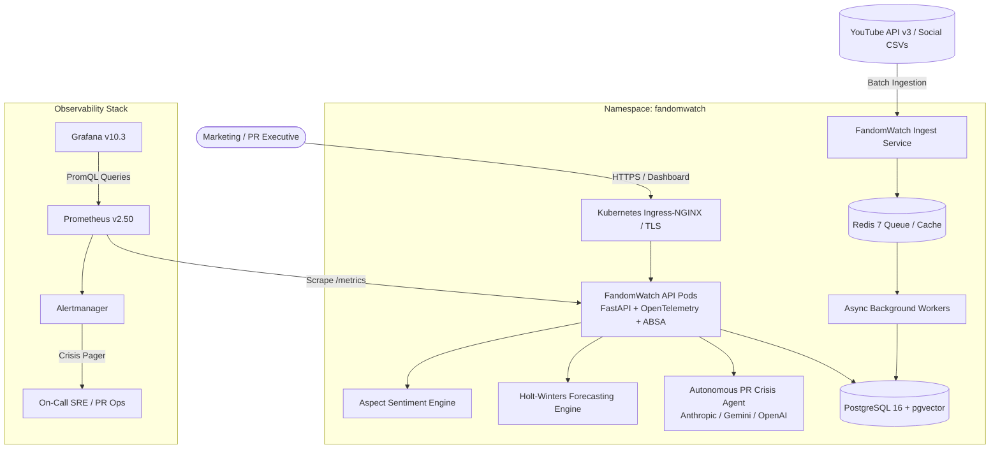

# FandomWatch: Enterprise Fan-Conversation Intelligence & AI Anomaly Platform

[](https://github.com/SriRamkunamsetty/fandom-tracker/actions/workflows/ci.yml)
[](https://github.com/SriRamkunamsetty/fandom-tracker/actions/workflows/codeql.yml)
[](https://github.com/SriRamkunamsetty/fandom-tracker/blob/main/deploy/docker/Dockerfile)
[](https://github.com/SriRamkunamsetty/fandom-tracker/tree/main/deploy/k8s)
[](https://github.com/SriRamkunamsetty/fandom-tracker/tree/main/deploy/helm/fandomwatch)
[](https://github.com/SriRamkunamsetty/fandom-tracker/blob/main/deploy/prometheus/prometheus.yml)
[](https://github.com/SriRamkunamsetty/fandom-tracker)
[](LICENSE)

What are audiences saying about an entertainment title, which **creative aspects** do they praise or condemn, which **narrative themes** are accelerating, and **when did an audience backlash erupt and what is the tactical response plan?**

**FandomWatch** is an enterprise-grade social intelligence platform that combines **Aspect-Based Sentiment Analysis (ABSA)**, **dense semantic narrative clustering**, **MAD robust-z anomaly detection**, **Holt-Winters predictive forecasting**, and **autonomous AI crisis response playbooks** inside a hardened, cloud-native Kubernetes architecture.

---

## Architecture



---

## Core Capabilities

### 1. Heavy AI / ML Suite (`src/fandomwatch/ml`)
- **Sentence-Level ABSA**: Evaluates comments at the sentence boundary (`[.!?\n]+`) attributing sentiment specifically to aspects (`acting`, `story`, `visuals`, `music`, `pacing`, `humor`, `casting`, `price`, `marketing`). *"Great acting, terrible story"* is split into $+1.0$ acting and $-1.0$ story rather than neutralizing each other.
- **Dense Vector Retrieval & Semantic Search**: 64/128-dimensional hybrid semantic anchor embeddings with subword hashing and cosine ranking for rapid discovery across millions of fan comments.
- **Semantic Narrative Clustering**: Unsupervised greedy single-pass centroid clustering over TF-IDF and dense embeddings. Extracts recurring fan narrative threads, dominant keywords, and representative exemplars.
- **Robust-Z Anomaly & Backlash Detection**: Sliding-window Median Absolute Deviation (MAD) scaled outlier detection ($z \ge 3.5\sigma$, $\text{neg\_share} \ge 35\%$, $N \ge 20$). Coalesces contiguous storm days into categorized incidents (`watch`, `high`, `critical`).
- **Holt-Winters Time-Series Forecaster**: Double exponential smoothing (level + trend) with 95% prediction intervals to project negative sentiment evolution 7 to 14 days into the future and flag threshold breaches early.
- **Autonomous PR Crisis Response Agent**: Synthesizes structured executive briefing playbooks, audience friction root causes, leadership talking points, and community statements upon crisis detection.

### 2. Enterprise Cloud-Native & DevOps (`deploy/`)
- **Multi-Stage Dockerfile**: Secure non-root (`UID 10001`), hardened, minimal container footprint with built-in healthchecks.
- **Full-Stack Docker Compose**: Orchestrates API, PostgreSQL 16 (with `pgvector`), Redis 7, Prometheus, and Grafana with pre-provisioned dashboards.
- **Kubernetes Production Manifests (`deploy/k8s`)**:
  - Replicated Deployment with rolling update strategy (`maxSurge: 1`, `maxUnavailable: 0`).
  - Strict Pod Security Standards (`restricted`).
  - HorizontalPodAutoscaler (HPA) scaling pods from 2 to 10 on CPU ($70\%$) and Memory ($80\%$).
  - PodDisruptionBudget (PDB) guaranteeing high availability during cluster drains.
  - Zero-trust NetworkPolicies isolating ingress/egress.
- **Production Helm Chart (`deploy/helm/fandomwatch`)**:
  - Fully parameterizable Helm v3 chart with ingress, cert-manager TLS, autoscaling, and metrics annotations.

### 3. Observability & SRE
- **Prometheus Metrics**: Exposes `/metrics` with custom counters and histograms:
  - `fandom_http_requests_total`
  - `fandom_http_request_duration_seconds`
  - `fandom_comments_ingested_total`
  - `fandom_backlash_episodes_active`
- **Pre-Configured Grafana Dashboard**: Ingestion rate, net sentiment gauges, P95/P99 latency distribution, and active crisis counters.
- **Alertmanager Rules**: Immediate alerts on critical backlash detection (`BacklashCriticalIncidentDetected`) and elevated 5xx error rates.

### 4. CI / CD Pipeline (`.github/workflows`)
- **Automated Quality Gate**: Ruff linting, Mypy strict type checking.
- **Security Scanning**: Bandit SAST analysis, pip-audit dependency vulnerability scanning, Aqua Trivy container scan, and GitHub CodeQL.
- **Multi-Python Matrix**: Automated testing across Python 3.10, 3.11, and 3.12.
- **Helm Validation**: Automated `helm lint` and dry-run template rendering.
- **Automated Delivery**: Multi-arch container builds (`linux/amd64`, `linux/arm64`) pushed to GitHub Container Registry (`ghcr.io`).

---

## Quick Start

### 1. Local Installation & Development

```bash
git clone https://github.com/SriRamkunamsetty/fandom-tracker.git
cd fandom-tracker

# Install in development mode with all enterprise dependencies
pip install -e .[all,dev]

# Run full test suite (29 tests passing)
python -m unittest discover -s tests -v
```

### 2. CLI Intelligence Commands

```bash
# Generate full fandom report on synthetic demo data
fandomwatch report --demo --title "Steel Tide"

# Run 7-day Holt-Winters predictive sentiment forecast
fandomwatch forecast --demo --title "Steel Tide" --days 7

# Generate Autonomous PR Crisis Response Brief
fandomwatch crisis-brief --demo --title "Steel Tide"

# Execute semantic vector search across comments
fandomwatch search --demo --title "Steel Tide" "greedy ticket prices"

# Start the interactive UI dashboard
fandomwatch serve --demo
```

### 3. Launching the Production REST API

```bash
# Start FastAPI production server with Swagger docs & Prometheus metrics
fandomwatch api --host 0.0.0.0 --port 8000
```
- Interactive Swagger UI: `http://localhost:8000/docs`
- Redoc Documentation: `http://localhost:8000/redoc`
- Prometheus Metrics: `http://localhost:8000/metrics`
- Liveness & Readiness Probes: `http://localhost:8000/livez`, `http://localhost:8000/readyz`

### 4. Docker Compose Full Stack

```bash
# Spin up API, PostgreSQL (pgvector), Redis, Prometheus, and Grafana
make docker-up
```
- FandomWatch API: `http://localhost:8000`
- Grafana Dashboard: `http://localhost:3000` (User: `admin` / Pass: `admin`)
- Prometheus Console: `http://localhost:9090`

### 5. Deploy to Kubernetes via Helm

```bash
helm upgrade --install fandomwatch deploy/helm/fandomwatch \
  --namespace fandomwatch \
  --create-namespace \
  --set ingress.hosts[0].host=fandom.yourdomain.com
```

---

## Project Layout

```
fandom-tracker/
├── .github/workflows/
│   ├── ci.yml                 # Multi-stage CI: Ruff, Mypy, Bandit, pip-audit, Pytest, Helm, Trivy
│   ├── cd.yml                 # Continuous Deployment: Multi-arch Docker & Helm OCI to GHCR
│   └── codeql.yml             # GitHub CodeQL static analysis
├── deploy/
│   ├── docker/
│   │   └── Dockerfile         # Multi-stage hardened non-root container
│   ├── docker-compose.yml     # Full stack: API, Postgres+pgvector, Redis, Prometheus, Grafana
│   ├── prometheus/            # Prometheus scrape config and backlash alert rules
│   ├── grafana/               # Provisioned datasources and production dashboard JSON
│   ├── k8s/                   # Raw Kubernetes manifests (Deployment, HPA, PDB, Ingress, NetPol)
│   └── helm/fandomwatch/      # Production Helm v3 chart (templates, values.yaml, Chart.yaml)
├── src/fandomwatch/
│   ├── api/                   # Production FastAPI REST & Prometheus endpoints
│   ├── ml/                    # AI/ML Layer: ABSA, Embeddings, Clustering, Anomaly, Forecaster, Agent
│   ├── config.py              # Pydantic environment configuration
│   ├── logging.py             # 12-factor JSON structured logger
│   ├── metrics.py             # Prometheus metrics registry
│   ├── cli.py                 # CLI interface with ML forecast, crisis-brief, search
│   ├── db.py                  # Dual dialect SQLite & PostgreSQL connection pool
│   ├── schema.sql             # SQL DDL with pgvector, backlash, and model tracking
│   ├── stats.py               # Wilson score interval, robust MAD z-scores
│   ├── fandom.py              # Core domain logic
│   ├── ingest.py              # YouTube API v3 ingestion with exponential backoff & quota tracker
│   └── sample_data.py         # Deterministic synthetic testbed with injected crisis
├── tests/
│   ├── test_core.py           # Statistical, sentiment, and aspect unit tests
│   ├── test_delivery.py       # Ingestion, socket retry, and server tests
│   ├── test_ml.py             # ABSA, embeddings, clustering, forecasting, and agent tests
│   └── test_api.py            # FastAPI endpoints, metrics, and health probe tests
├── docs/
│   ├── ARCHITECTURE.md        # C4 model, scalability, and disaster recovery specs
│   ├── MLOPS.md               # ML formulations, drift detection, evaluation runbook
│   └── KUBERNETES.md          # Kubernetes operations, HPA, and incident response runbook
├── Makefile                   # Developer productivity commands
└── pyproject.toml             # Packaging with enterprise optional extras
```

---

## License

This project is licensed under the Apache-2.0 License.
Author: **SriRamKunamsetty** ([mohansriramkunamsetty@gmail.com](mailto:mohansriramkunamsetty@gmail.com)).
