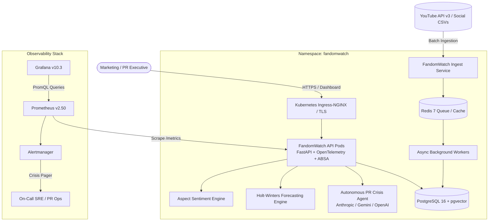

# FandomWatch Enterprise Architecture

## 1. System Context & Container Overview (C4 Model)

---

## 2. Component Architecture

### 2.1 API Service (`src/fandomwatch/api`)
- **Framework**: FastAPI (async Python 3.10+) with Pydantic v2 schemas.
- **Middleware**:
  - Request latency histogram and status counter instrumentation (`fandom_http_requests_total`, `fandom_http_request_duration_seconds`).
  - Strict Content-Security-Policy and CORS controls.
  - Non-leaking JSON error response envelope.
- **Key Endpoints**:
  - `/healthz`, `/livez`, `/readyz`: High-frequency probes for Kubernetes kubelet.
  - `/metrics`: Standard Prometheus metrics exposition format.
  - `/api/v1/fandom/{id}/forecast`: 7-14 day Holt-Winters predictive trajectory.
  - `/api/v1/fandom/{id}/crisis-brief`: Autonomous PR response brief with executive talking points.
  - `/api/v1/fandom/{id}/search`: High-speed semantic vector similarity search.

### 2.2 AI/ML Analytical Layer (`src/fandomwatch/ml`)
- **Aspect-Based Sentiment Analysis (`absa.py`)**:
  - Sentence tokenization via regex boundary splitting.
  - Aspect term extraction across 9 core creative dimensions (`acting`, `story`, `visuals`, `music`, `pacing`, `humor`, `casting`, `price`, `marketing`).
  - Negation inversion (3-token lookback window) and intensifier scaling.
  - 95% Wilson confidence intervals for negative proportion estimation.
- **Dense Vector Embeddings & Retrieval (`embeddings.py`)**:
  - Hybrid semantic anchor projection + subword hashing.
  - Unit L2 normalization for high-performance cosine similarity calculations.
  - Pluggable external embeddings (OpenAI `text-embedding-3-small` / local transformer models).
- **Narrative Clustering (`clustering.py`)**:
  - Dense-sparse hybrid centroid vector representation.
  - Greedy single-pass clustering with dynamic centroid recalculation.
  - Automatic keyword extraction and representative quote selection.
- **Backlash Anomaly Detection (`anomaly.py`)**:
  - Sliding-window Median Absolute Deviation (MAD) robust z-score:
    $$z_i = 0.6745 \cdot \frac{x_i - \text{median}(X)}{\max(\text{MAD}, 0.05)}$$
  - Multi-condition gating: $z \ge 3.5$, negative share $\ge 35\%$, negative comments $\ge 10$, daily volume $\ge 20$.
  - Contiguous day coalescing into named incidents with severity tiers (`watch`, `high`, `critical`).
- **Predictive Time-Series Forecaster (`forecasting.py`)**:
  - Holt’s linear exponential smoothing for level and trend tracking:
    $$\ell_t = \alpha y_t + (1-\alpha)(\ell_{t-1} + b_{t-1})$$
    $$b_t = \beta(\ell_t - \ell_{t-1}) + (1-\beta)b_{t-1}$$
  - $h$-step projection with $95\%$ prediction intervals.
- **Autonomous Crisis Agent (`agent.py`)**:
  - Translates quantitative backlash signals into qualitative studio defense playbooks with executive summaries, friction root causes, talking points, and community statements.

---

## 3. Storage Layer & High Availability

| Layer | Engine | Configuration |
|---|---|---|
| **Primary Relational DB** | PostgreSQL 16 | Primary-Replica StatefulSet with `pgvector` extension |
| **Development DB** | SQLite 3 | Embedded fallback with automatic dialect translation |
| **Cache & Task Broker** | Redis 7 | In-memory append-only persistence (`AOF`) |
| **High Availability** | Kubernetes PDB | `minAvailable: 1`, rolling update `maxUnavailable: 0` |
| **Autoscaling** | Kubernetes HPA | 2 to 10 replicas scaling on CPU ($70\%$) and Memory ($80\%$) |
